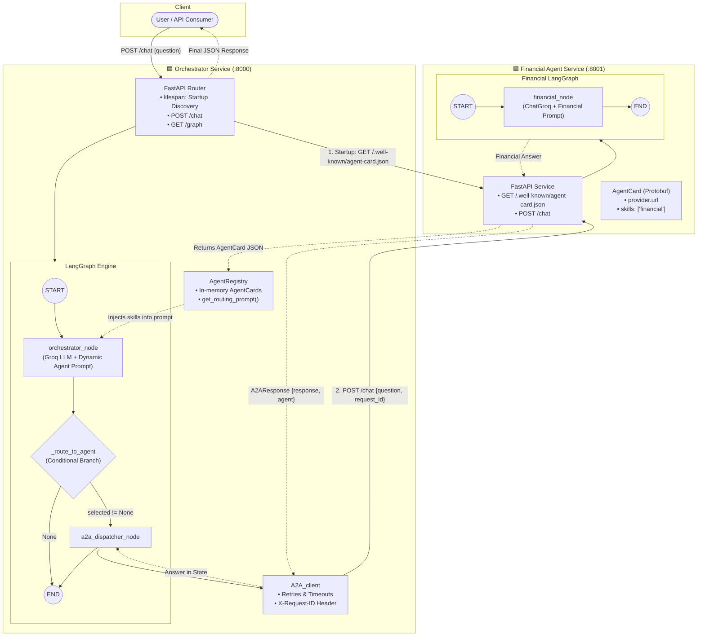
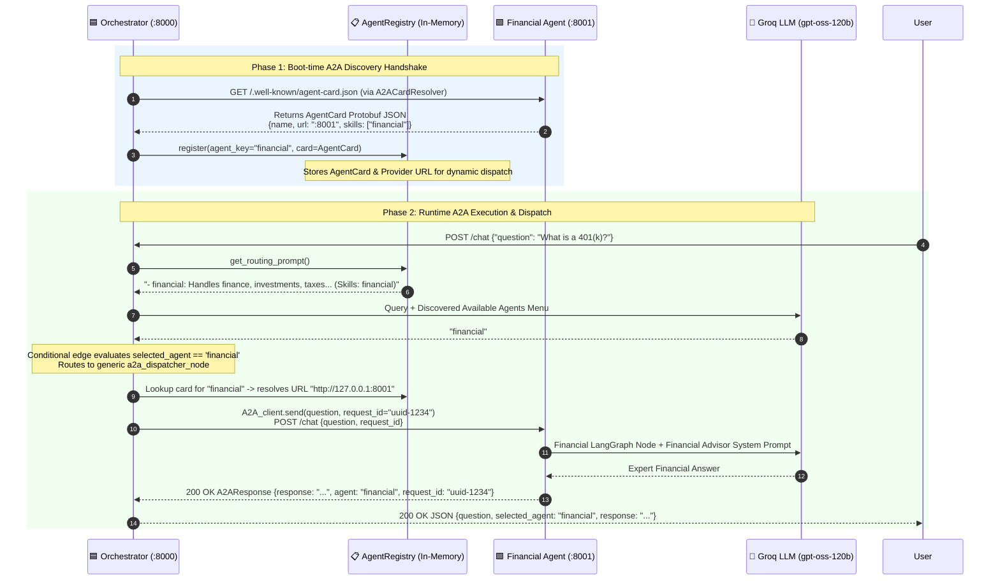
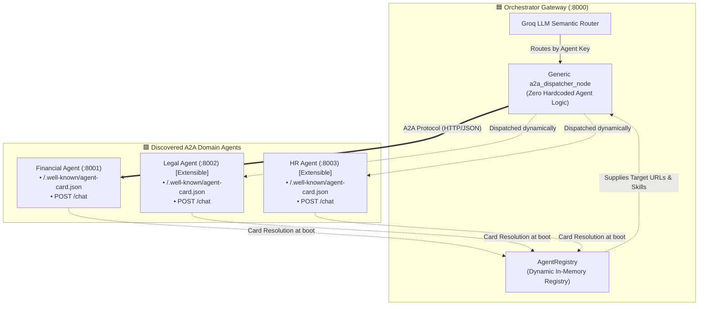

# Agent-to-Agent (A2A) Distributed Orchestrator

A production-ready **Agent-to-Agent (A2A)** architecture built with **FastAPI**, **LangGraph**, and **Groq (`gpt-oss-120b` / `llama3-70b`)**.

This system implements dynamic multi-agent orchestration:
- An **Orchestrator Service** that discovers downstream agents at boot via the official A2A `AgentCard` protocol.
- A **Dynamic Semantic Router** powered by LangGraph and Groq that routes incoming user questions to the right specialist.
- A **Generic A2A Dispatcher** that dynamically connects to discovered agents without hardcoded agent-specific nodes.
- A **Financial Agent Service** that publishes its capabilities (`agent-card.json`) and answers complex financial and investment questions.

---

## 🏗️ Architecture Overview



---

## 🏛️ A2A Protocol Interaction Lifecycle

The system operates across two distinct protocol phases: **Boot-time Discovery** and **Runtime A2A Execution**.



---

## 🌐 A2A Multi-Agent Discovery & Registry Topology

The generic `a2a_dispatcher_node` enables an extensible hub-and-spoke multi-agent topology without code modifications:



---

## 📦 A2A Protocol Wire Contract

The communication follows standard typed contracts across both nodes:

| Protocol Stage | Endpoint | Request Payload | Response Payload |
|---|---|---|---|
| **Discovery** | `GET /.well-known/agent-card.json` | *None* | `AgentCard` (Protobuf JSON: `name`, `version`, `provider.url`, `skills`, `capabilities`) |
| **A2A Chat** | `POST /chat` | `{"question": str, "request_id": str}` | `{"response": str, "agent": str, "request_id": str}` |
| **Health** | `GET /health` | *None* | `{"status": "ok"}` |

---

## 📁 Repository Structure

```text
A2A practice/
├── .vscode/
│   └── launch.json            # VS Code multi-server compound debugger
├── orchestrator/
│   ├── config.py              # Settings & AGENT_URLS dictionary
│   ├── discovery.py           # A2ACardResolver & AgentRegistry engine
│   ├── schema.py              # UserQuery, A2ARequest, A2AResponse models
│   ├── A2A_client.py          # Resilient HTTP client for A2A transport
│   ├── main.py                # Orchestrator FastAPI app (Port 8000)
│   └── graph/
│       ├── state.py           # orchestratorState TypedDict
│       ├── nodes.py           # orchestrator_node & a2a_dispatcher_node
│       └── graph.py           # LangGraph StateGraph with conditional edge
├── financial/
│   ├── config.py              # Financial service settings
│   ├── schema.py              # FinancialRequest and FinancialResponse schemas
│   ├── agent_card.py          # Protobuf AgentCard definition & serialization
│   ├── main.py                # Financial FastAPI app (Port 8001)
│   ├── server.py              # Standalone Uvicorn runner
│   └── graph/
│       ├── state.py           # FinancialState TypedDict
│       ├── nodes.py           # financial_node (Groq financial advisor prompt)
│       └── graph.py           # Financial service LangGraph workflow
├── .env                       # Environment variables (API keys & endpoints)
├── .gitignore                 # Git ignore rules
└── requirements.txt           # Project dependencies
```

---

## 🚀 Getting Started

### 1. Prerequisites
- Python 3.10+
- A Groq API key (from [console.groq.com](https://console.groq.com))

### 2. Environment Setup

Create and activate a virtual environment:
```powershell
python -m venv venv
.\venv\Scripts\Activate.ps1   # Windows PowerShell
```

Install the dependencies:
```powershell
pip install -r requirements.txt
```

### 3. Configure `.env`

Create a `.env` file in the root directory:
```env
GROK_API_KEY=your_groq_api_key_here
GROK_MODEL_NAME=gpt-oss-120b
FINANCIAL_AGENT_URL=http://127.0.0.1:8001
```

---

## 🏃 Running the Services

### Option A: VS Code Debugger (Recommended)
1. Open the repository in VS Code.
2. Go to **Run & Debug** (`Ctrl + Shift + D`).
3. Select **`Run Both Services (Orchestrator + Financial)`** from the top dropdown.
4. Press **F5**. Both services will launch simultaneously with live breakpoint debugging.

### Option B: Terminal Invocations

**Terminal 1 — Start the Financial Agent (Port 8001):**
```powershell
.\venv\Scripts\uvicorn financial.main:app --host 127.0.0.1 --port 8001 --reload
```

**Terminal 2 — Start the Orchestrator (Port 8000):**
```powershell
.\venv\Scripts\uvicorn orchestrator.main:app --host 127.0.0.1 --port 8000 --reload
```

---

## 📡 API Endpoints & Testing

### 1. Orchestrator Health
```bash
curl http://127.0.0.1:8000/health
```
**Response:**
```json
{"status": "ok"}
```

### 2. Visualizing the Orchestrator LangGraph
Open in browser:
```text
http://127.0.0.1:8000/graph
```
Returns a rendered PNG diagram of the active LangGraph routing state.

### 3. Financial Agent Card (Discovery Endpoint)
```bash
curl http://127.0.0.1:8001/.well-known/agent-card.json
```
**Response:**
```json
{
  "name": "Financial Agent",
  "description": "Specialized agent for financial advice, investments, taxes, banking, budgeting, and cryptocurrency.",
  "version": "1.0.0",
  "provider": {
    "url": "http://127.0.0.1:8001",
    "organization": "My Finance Co."
  },
  "skills": [
    {
      "id": "financial_advisory",
      "name": "financial",
      "description": "Handles questions related to finance, investments, stocks, budgeting, accounting, taxes, banking, cryptocurrency, and economic data."
    }
  ]
}
```

### 4. End-to-End Chat Routing
Send a user query to the Orchestrator:
```bash
curl -X POST http://127.0.0.1:8000/chat \
  -H "Content-Type: application/json" \
  -d '{"question": "What is the difference between a traditional 401(k) and a Roth IRA?"}'
```

**Response:**
```json
{
  "question": "What is the difference between a traditional 401(k) and a Roth IRA?",
  "selected_agent": "financial",
  "response": "A Traditional 401(k) is an employer-sponsored retirement account where contributions are made pre-tax... A Roth IRA is an individual retirement account funded with after-tax dollars..."
}
```

---

## 🧩 Adding a New Agent (Zero Orchestrator Graph Changes)

Because the system uses an **`a2a_dispatcher_node`** with dynamic discovery:

1. **Build the New Agent Service** (e.g. `legal` on `127.0.0.1:8002`):
   - Expose `/.well-known/agent-card.json` with skill descriptions.
   - Expose `POST /chat`.
2. **Add the URL to `orchestrator/config.py`**:
   ```python
   AGENT_URLS: dict = {
       "financial": "http://127.0.0.1:8001",
       "legal": "http://127.0.0.1:8002",  # 👈 Added in 1 line
   }
   ```
3. **Done!**
   - At startup, the Orchestrator fetches the legal agent card.
   - The Groq router immediately recognizes legal questions and routes them to `a2a_dispatcher_node`.
   - **Zero graph or node code changes required.**

---

## 🛡️ License
MIT License. Built for distributed agentic architectures.

